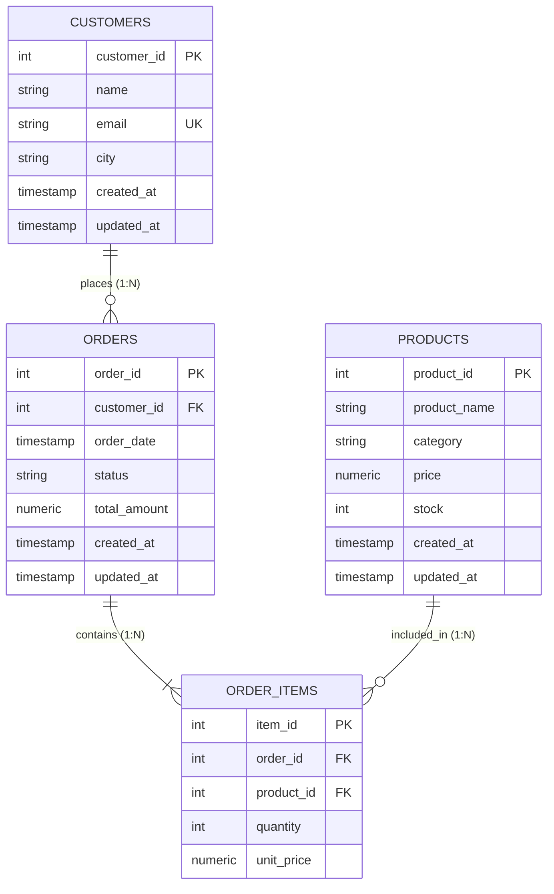

# InsightIQ AI — Enterprise Data Warehouse Data Dictionary

**Document Version:** 1.0.0  
**Target Database:** PostgreSQL 16 / SQLAlchemy 2.x  
**Schema Model:** 3NF Relational E-Commerce Analytics Warehouse

---

## 1. Entity-Relationship Overview



---

## 2. Table Specifications

### 2.1 `customers` Table
Represents registered retail consumers and organizational buyers.

| Column Name | SQL Type | Python / Pydantic Type | Nullable | Default | Constraints & Indexes | Description |
| :--- | :--- | :--- | :---: | :---: | :--- | :--- |
| `customer_id` | `INTEGER` | `int` | **NO** | Auto-inc | **PRIMARY KEY** | Unique system surrogate identifier for customer. |
| `name` | `VARCHAR(150)` | `str` | **NO** | — | — | Full customer or company contact name. |
| `email` | `VARCHAR(255)` | `str` | **NO** | — | **UNIQUE INDEX** (`uq_customers_email`) | Unique communication and login email address. |
| `city` | `VARCHAR(100)` | `str` | **NO** | — | **INDEX** (`ix_customers_city`) | Metropolitan city of registration for regional analytics. |
| `created_at` | `TIMESTAMP WITH TIME ZONE` | `datetime` | **NO** | `NOW()` | — | Exact UTC timestamp of account registration. |
| `updated_at` | `TIMESTAMP WITH TIME ZONE` | `datetime` | **NO** | `NOW()` | — | UTC timestamp of most recent profile modification. |

---

### 2.2 `products` Table
Represents catalog inventory items available for purchase across merchandise categories.

| Column Name | SQL Type | Python / Pydantic Type | Nullable | Default | Constraints & Indexes | Description |
| :--- | :--- | :--- | :---: | :---: | :--- | :--- |
| `product_id` | `INTEGER` | `int` | **NO** | Auto-inc | **PRIMARY KEY** | Unique system surrogate identifier for product SKU. |
| `product_name` | `VARCHAR(200)` | `str` | **NO** | — | — | Descriptive commercial product name. |
| `category` | `VARCHAR(100)` | `str` | **NO** | — | **INDEX** (`ix_products_category`) | Merchandise taxonomy group (Electronics, Apparel, etc.). |
| `price` | `NUMERIC(10, 2)` | `Decimal` | **NO** | — | **CHECK** (`ck_products_price_non_negative: price >= 0`) | Current standard retail selling price per unit. |
| `stock` | `INTEGER` | `int` | **NO** | `0` | **CHECK** (`ck_products_stock_non_negative: stock >= 0`) | Live on-hand inventory count in central fulfillment. |
| `created_at` | `TIMESTAMP WITH TIME ZONE` | `datetime` | **NO** | `NOW()` | — | UTC timestamp of product creation in catalog. |
| `updated_at` | `TIMESTAMP WITH TIME ZONE` | `datetime` | **NO** | `NOW()` | — | UTC timestamp of catalog item update. |

---

### 2.3 `orders` Table
Captures header-level transactional events placed by customers.

| Column Name | SQL Type | Python / Pydantic Type | Nullable | Default | Constraints & Indexes | Description |
| :--- | :--- | :--- | :---: | :---: | :--- | :--- |
| `order_id` | `INTEGER` | `int` | **NO** | Auto-inc | **PRIMARY KEY** | Unique system invoice/transaction identifier. |
| `customer_id` | `INTEGER` | `int` | **NO** | — | **FOREIGN KEY** (`customers.customer_id`, ON DELETE CASCADE), **INDEX** | Identifier of purchasing customer account. |
| `order_date` | `TIMESTAMP WITH TIME ZONE` | `datetime` | **NO** | `NOW()` | **COMPOSITE INDEX** (`ix_orders_date_status: (order_date, status)`) | Exact UTC timestamp transaction was confirmed. |
| `status` | `VARCHAR(50)` | `str` | **NO** | `'pending'` | **INDEX** (`ix_orders_status`) | Order fulfillment lifecycle stage (`completed`, `pending`, `cancelled`, `returned`). |
| `total_amount` | `NUMERIC(12, 2)` | `Decimal` | **YES** | `0.00` | **CHECK** (`total_amount >= 0`) | Header gross amount pre-computed or cached. |
| `created_at` | `TIMESTAMP WITH TIME ZONE` | `datetime` | **NO** | `NOW()` | — | Audit timestamp of order record creation. |
| `updated_at` | `TIMESTAMP WITH TIME ZONE` | `datetime` | **NO** | `NOW()` | — | Audit timestamp of status or item modification. |

---

### 2.4 `order_items` Table
Captures individual line-item sales records, prices at time of transaction, and unit volumes.

| Column Name | SQL Type | Python / Pydantic Type | Nullable | Default | Constraints & Indexes | Description |
| :--- | :--- | :--- | :---: | :---: | :--- | :--- |
| `item_id` | `INTEGER` | `int` | **NO** | Auto-inc | **PRIMARY KEY** | Unique line item identifier. |
| `order_id` | `INTEGER` | `int` | **NO** | — | **FOREIGN KEY** (`orders.order_id`, ON DELETE CASCADE), **COMPOSITE INDEX** (`ix_order_items_order_product`) | Parent order reference. |
| `product_id` | `INTEGER` | `int` | **NO** | — | **FOREIGN KEY** (`products.product_id`, ON DELETE RESTRICT), **INDEX** | Catalog SKU reference. |
| `quantity` | `INTEGER` | `int` | **NO** | `1` | **CHECK** (`ck_order_items_qty_positive: quantity > 0`) | Units purchased in transaction. |
| `unit_price` | `NUMERIC(10, 2)` | `Decimal` | **NO** | — | **CHECK** (`ck_order_items_price_non_neg: unit_price >= 0`) | Actual price charged per unit at transaction time. |

---

## 3. Business Calculation Definitions & Rules

### 3.1 Order Eligibility & Status Exclusions
```sql
-- Qualifying Analytical Orders Condition:
WHERE orders.status NOT IN ('cancelled', 'returned')
```
- **Included Statuses:** `completed`, `pending` (pending orders represent authorized receivables).
- **Excluded Statuses:** `cancelled` (aborted prior to fulfillment) and `returned` (refunded inventory returns).
- **Enforcement:** Applied universally across Sales, Product, Customer, Dashboard, and Export queries.

### 3.2 Total Revenue
```sql
SELECT COALESCE(SUM(order_items.quantity * order_items.unit_price), 0.00) AS total_revenue
FROM orders
JOIN order_items ON orders.order_id = order_items.order_id
WHERE orders.status NOT IN ('cancelled', 'returned');
```

### 3.3 Average Order Value (AOV)
$$\text{AOV} = \frac{\text{Total Revenue}}{\text{Total Qualifying Orders}}$$
- If Qualifying Orders $= 0$, $\text{AOV} = \$0.00$ (ZeroDivisionError protected).

### 3.4 Repeat Customer Rate
$$\text{Repeat Rate \%} = \left( \frac{\text{Count of Customers with } \ge 2 \text{ completed orders}}{\text{Total Distinct Customers with } \ge 1 \text{ completed order}} \right) \times 100$$

### 3.5 Period-over-Period Revenue Growth
$$\text{Revenue Growth \%} = \left( \frac{\text{Revenue}_{\text{current}} - \text{Revenue}_{\text{previous}}}{\text{Revenue}_{\text{previous}}} \right) \times 100$$
- If $\text{Revenue}_{\text{previous}} = 0$, returns `None` (or $100.0\%$ if current $>0$).
