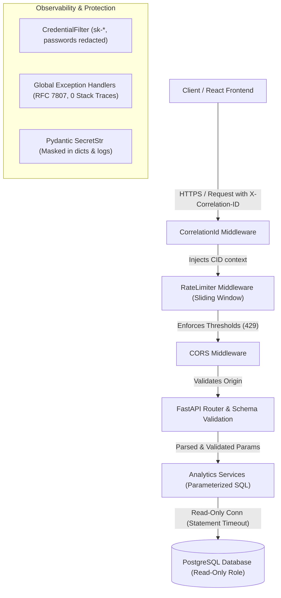

# InsightIQ AI — Security Architecture & Hardening Guide

## 1. Executive Summary

InsightIQ AI is an enterprise-grade Autonomous Business Intelligence Analyst that queries corporate data warehouses to answer executive questions. Operating in proximity to sensitive analytical databases and third-party LLM APIs (OpenAI) necessitates a robust, defense-in-depth security architecture.

This document outlines the security controls, policies, and hardening measures implemented across the application lifecycle to guarantee confidentiality, integrity, availability, and regulatory compliance.

---

## 2. Threat Modeling & Security Principles

InsightIQ AI adheres to the following core tenets:

1. **Principle of Least Privilege (PoLP):** All components operate with only the minimum privileges needed to perform their tasks. AI analytics queries execute against read-only database roles.
2. **Zero-Trust Input Handling:** All external inputs (HTTP requests, query parameters, user prompts) are considered untrusted and validated against strict schemas before execution.
3. **No Direct/Unsanitized LLM SQL Execution:** LLMs never directly execute arbitrary SQL queries against the production database. All analytical data access is channeled through predefined, parameterized SQLAlchemy query services.
4. **Zero Secrets Leakage:** API tokens, database credentials, and cryptographic keys are strictly excluded from source control, logs, error responses, and client payloads.
5. **Traceability and Observability:** Every request carries an immutable correlation identifier (`X-Correlation-ID`) tracked across middleware, application logs, database queries, and downstream API calls.



---

## 3. Configuration & Secrets Protection

### 3.1 Pydantic BaseSettings & `SecretStr`
Application configuration is centralized in `app.config.Settings` using Pydantic Settings. Sensitive configuration values—such as `OPENAI_API_KEY`, `POSTGRES_PASSWORD`, and `ANALYTICS_READONLY_PASSWORD`—are wrapped in Pydantic's `SecretStr`.

Key benefits:
- Prevents accidental exposure via `repr()`, `str()`, or automated serialization (`model_dump()`).
- Exposes explicit retrieval methods (`get_secret_value()`) only at point of consumption.
- Offers `settings.safe_dict()` for debugging or health probes where sensitive values are automatically replaced with `******`.

### 3.2 Environment Variable Hygiene
- All environment configurations reside in a `.env` file excluded from version control via `.gitignore`.
- An audited template `.env.example` provides explicit variable keys, documentation, and safe defaults without values.
- Missing required credentials fail fast at startup during settings validation.

---

## 4. Structured Logging & Secret Redaction

### 4.1 Request Correlation IDs
Every incoming HTTP request is assigned a unique UUID4 correlation ID via `CorrelationIdMiddleware` (or adopts an existing `X-Correlation-ID` header supplied by an API gateway or upstream proxy).

- The ID is stored in Python's thread-safe / async-safe `contextvars.ContextVar`.
- Structured logging automatically includes `[cid:<correlation_id>]` on every log record.
- The `X-Correlation-ID` is echoed back in the response headers of all requests, including error responses.

### 4.2 Credential Redaction (`CredentialFilter`)
All application loggers pass through a custom `logging.Filter` (`CredentialFilter`) that scrubs:
- OpenAI API Keys (`sk-[a-zA-Z0-9_-]{20,}`)
- Passwords in key-value strings (`password=...`, `"password": "..."`)
- Authorization Bearer tokens (`Bearer [a-zA-Z0-9._-]{20,}`)

Even if an engineer accidentally logs an unmasked request body or connection string, the filter replaces sensitive tokens with masked asterisks before writes occur to standard output or log streams.

---

## 5. API Security & Rate Limiting

### 5.1 Denial of Service (DoS) Mitigation
`RateLimitMiddleware` implements an in-memory sliding-window algorithm tracking client IP addresses.

- Default limits: **120 requests per 60-second window** per client IP (configurable via `RATE_LIMIT_MAX_REQUESTS` and `RATE_LIMIT_WINDOW_SECONDS`).
- Health check probes (`/health`, `/api/health`) and OpenAPI documentation endpoints (`/docs`, `/redoc`) are exempt from throttling.
- Exceeded limits return HTTP status **429 Too Many Requests**, providing an RFC-compliant `Retry-After` header and structured JSON error response.

### 5.2 Strict CORS Restrictions
CORS is explicitly configured using FastAPI's `CORSMiddleware`. Allowed origins are loaded from `settings.CORS_ORIGINS` (e.g. `http://localhost:5173`, `http://localhost:3000`), preventing unauthorized cross-origin requests from malicious domains.

---

## 6. Safe Error Handling & Zero Information Leakage

### 6.1 Standardized RFC 7807 Error Responses
All API errors return a standardized JSON structure:

```json
{
  "error": "ValidationError",
  "detail": "start_date: Invalid date format. Expected YYYY-MM-DD",
  "status_code": 422,
  "correlation_id": "c3e981bc-bdfb-478a-a434-2e92c10b7f61"
}
```

### 6.2 Stack Trace Suppression
In production environments, returning raw Python tracebacks or database errors to API clients introduces reconnaissance vulnerabilities.

- The global `Exception` handler intercepts all unhandled errors.
- The full stack trace is logged internally with the request correlation ID for debugging.
- Normal API consumers receive a clean, generic HTTP 500 payload:
  `{"error": "Internal Server Error", "detail": "An unexpected server error occurred.", "status_code": 500, "correlation_id": "..."}`.

---

## 7. Database Security & LLM Sandboxing

### 7.1 SQL Injection Defense
- **100% Parameterized Queries:** All analytical queries in `sales_service.py`, `customer_service.py`, `product_service.py`, and `analytics_service.py` utilize SQLAlchemy 2.0 type-safe expressions (`select()`, `where()`, `func()`).
- **No Raw SQL Concatenation:** Query parameters (date ranges, pagination limits, filter categories) are bound via query compiler parameters, eliminating SQL injection vectors.
- **No Unrestricted LLM SQL:** When natural-language questions are processed by the LLM (in upcoming Phase 09), the LLM generates structured tool invocations (function calling) rather than direct SQL text executed against the database.

### 7.2 Read-Only Database Role
Analytical and AI workloads run against a dedicated PostgreSQL user with restricted permissions:

```sql
-- Step 1: Create dedicated read-only role
CREATE ROLE insightiq_readonly WITH LOGIN PASSWORD 'strong_readonly_password';

-- Step 2: Grant connection rights to the database
GRANT CONNECT ON DATABASE insightiq_db TO insightiq_readonly;

-- Step 3: Grant schema usage
GRANT USAGE ON SCHEMA public TO insightiq_readonly;

-- Step 4: Grant SELECT privilege on analytical tables only
GRANT SELECT ON ALL TABLES IN SCHEMA public TO insightiq_readonly;

-- Step 5: Enforce read-only for future tables
ALTER DEFAULT PRIVILEGES IN SCHEMA public GRANT SELECT ON TABLES TO insightiq_readonly;

-- Step 6: Revoke write and DDL privileges
REVOKE INSERT, UPDATE, DELETE, TRUNCATE, REFERENCES, TRIGGER ON ALL TABLES IN SCHEMA public FROM insightiq_readonly;
REVOKE CREATE ON SCHEMA public FROM insightiq_readonly;
```

### 7.3 Database Timeouts & Resource Controls
To guard against analytical query resource exhaustion (e.g. runaway aggregation or cartesian joins):
- **Connection Timeout:** Managed via `DB_CONNECT_TIMEOUT_SECONDS=10`.
- **Statement Timeout:** PostgreSQL connections enforce server-side statement cancellation via `-c statement_timeout=30000` (30 seconds, controlled by `DB_COMMAND_TIMEOUT_SECONDS=30`).
- **Connection Pooling:** SQLAlchemy `QueuePool` with bounded `pool_size=10`, `max_overflow=20`, and `pool_recycle=1800` ensures pool hygiene and prevents socket exhaustion.

### 7.4 LLM API Timeout & Fail-Safes
Outgoing requests to the OpenAI API are constrained by `OPENAI_TIMEOUT_SECONDS=30` to prevent thread stalling during upstream LLM provider latency spikes.

---

## 8. Summary of Security Matrix

| Threat Category | Attack Vector | Security Countermeasure | Verification Test |
| :--- | :--- | :--- | :--- |
| **Credential Exposure** | Leaked API key in logs/git | `SecretStr`, `safe_dict()`, `.gitignore`, `CredentialFilter` | `test_security.py::test_secret_masking` |
| **Reconnaissance** | Stack trace disclosure in 500 errors | Global exception handler with sanitized RFC 7807 payloads | `test_security.py::test_internal_error_suppresses_stack_trace` |
| **Denial of Service** | API flooding | `RateLimitMiddleware` sliding window per client IP | `test_security.py::test_rate_limiter_blocks_burst_traffic` |
| **Request Tampering** | Traceability loss in distributed calls | `CorrelationIdMiddleware` propagating `X-Correlation-ID` | `test_security.py::test_correlation_id_propagation` |
| **SQL Injection** | Malicious query parameters or prompt injection | 100% SQLAlchemy 2.0 parameterized expressions, no raw SQL | `test_sales.py`, `test_api.py` |
| **Data Alteration** | Accidental or malicious DB modification by AI | Dedicated read-only PostgreSQL role (`GRANT SELECT ONLY`) | `docs/security_architecture.md` |
| **DB Exhaustion** | Runaway analytics queries | PostgreSQL `statement_timeout` & connection limits | `connection.py`, `config.py` |
